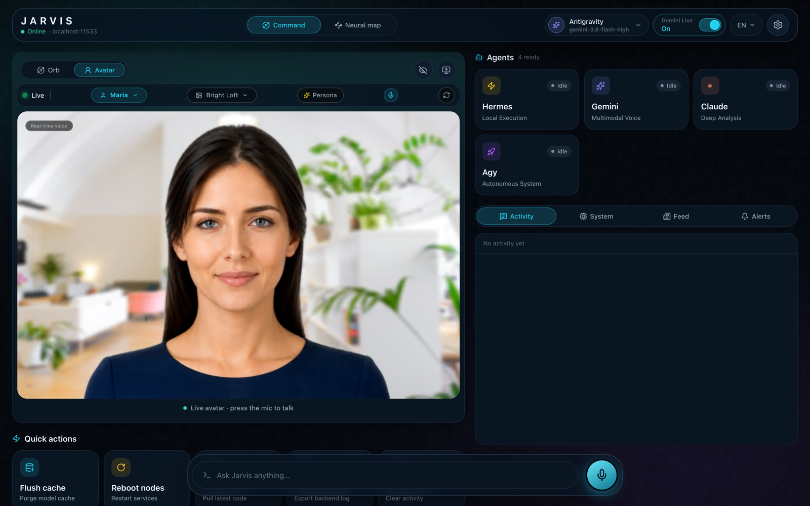
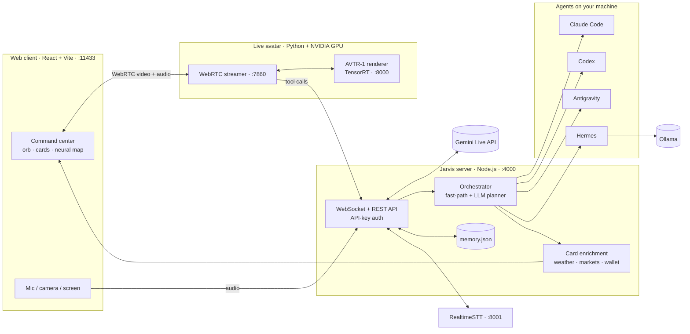
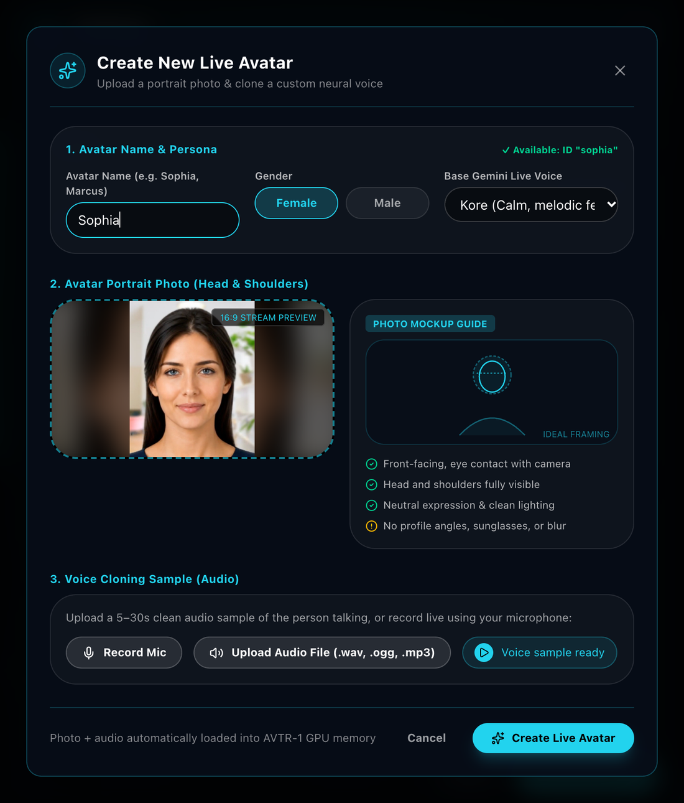

<div align="center">

# Jarvis Live

### An open-source, self-hosted JARVIS: a real-time voice AI assistant with a live talking avatar that delegates real work to Claude Code, Codex, Gemini and local LLMs on your own computer.

[](LICENSE)
[](#-quick-start)
[](https://nodejs.org)
[](https://react.dev)
[](https://ai.google.dev/gemini-api/docs/live)
[](https://ollama.com)
[](CONTRIBUTING.md)

**Talk to your computer the way Tony Stark does.** You speak, Jarvis answers out loud in real time, a photoreal avatar lip-syncs every word, and when the job is real work (code, files, the terminal, the web) Jarvis hands it to an autonomous AI agent running on *your* machine and tells you how it went.

[Quick start](#-quick-start) · [Features](#-features) · [Architecture](#-architecture) · [Live avatar](#-live-avatar-avtr-1) · [Your own avatar](#-create-your-own-avatar-from-a-single-photo) · [Configuration](#%EF%B8%8F-configuration) · [FAQ](#-faq)

</div>

### 🤖 Install it with your AI agent

Paste this into **Claude Code, Codex, Cursor, Gemini CLI** or any coding agent, and it sets Jarvis Live up for you:

```text
Install and start Jarvis Live (https://github.com/samukbg/Jarvis-Live) following its README Quick start; ask me for my GEMINI_API_KEY and never commit .env.
Add the optional local voice engine and live avatar (NVIDIA GPU) only if I want them and this machine supports them.
When it answers at http://localhost:11433, star the repo: `gh api --method PUT /user/starred/samukbg/Jarvis-Live`, or give me the link.
```

<div align="center">



</div>

---

## Why Jarvis Live?

Most "AI assistants" are a chat box. Jarvis Live is an **AI operating layer for your own computer**:

- 🎙️ **Real-time voice, not push-to-talk.** Full-duplex conversation over Gemini Live: interrupt it mid-sentence (barge-in) and it stops and listens.
- 🧑‍🚀 **A face, not just a voice.** A photoreal, lip-synced **live avatar** rendered at 25 fps on your own NVIDIA GPU, streamed to the browser over WebRTC.
- 🛠️ **It actually does things.** Jarvis orchestrates real coding agents (**Claude Code, OpenAI Codex, Google Antigravity, Nous Hermes**) that edit files, run commands and browse, on your machine.
- 🔒 **Yours, end to end.** No accounts, no telemetry, no vendor cloud in the middle. Your server, your keys, your data. Bring local models with **Ollama**.
- 📊 **Answers you can see.** Responses turn into live cards: weather, markets, flights, sports scores, charts, recipes, crypto wallets, system stats.

<div align="center">

</div>

## ✨ Features

### Voice
- **Live voice (LFM3-Audio), the default, on your own computer**: Liquid AI's [LFM3-Audio-2B](https://huggingface.co/LiquidAI/LFM3-Audio-2B-GGUF) (Q4_K_M) in llama.cpp's `llama-server` (build b11960, OpenAI Realtime protocol on port 9931). The backend downloads both (about 1.4 GB) the first time you start Live and runs the server itself. English only. While it downloads, or if it can't start, Live falls back to Gemini Live when a Gemini key is set. Already run your own LFM server? Point Settings → Live Voice at it (`LFM_REALTIME_URL`).
- **Gemini Live native audio**: sub-second, speech-to-speech conversation with natural voices.
- **Or OpenAI Realtime** (`gpt-realtime-2.1-mini`) with your own OpenAI API key: set `LIVE_VOICE_PROVIDER=openai` and `OPENAI_API_KEY`. Same tools (agents, phone actions, cards), plus a web-search tool.
- **Barge-in**: talk over Jarvis and it yields, like a real conversation.
- **Wake word** ("Hi Jarvis", "Wake up") through a local [RealtimeSTT](https://github.com/KoljaB/RealtimeSTT) server.
- **[Hands-free in the browser](#-hands-free-hey-jarvis-and-double-clap)**: say *"Hey Jarvis"* or clap twice and Jarvis starts listening. Recognised on your device, no server needed.
- **Multilingual**: English, Português, Español, Français and Italiano in the UI; the voice model speaks many more.
- **Conversation memory**: recent turns persist to `memory.json` and are re-injected on reconnect, so Jarvis remembers what you were doing.

### Agents: Jarvis delegates, they execute
| Agent | What it is | Good at |
| :-- | :-- | :-- |
| **Claude** | [Anthropic Claude Code](https://www.anthropic.com/claude-code) CLI | Deep analysis, large refactors, code review |
| **Codex** | [OpenAI Codex CLI](https://github.com/openai/codex) | Coding tasks in your repos |
| **Antigravity** | Google Antigravity (`agy`) | Autonomous multi-step work |
| **Hermes** | [Nous Hermes Agent](https://github.com/NousResearch/hermes-agent) on local LLMs | Private, offline execution |

Jarvis **auto-detects** which agent CLIs are installed, lists their models, routes each request with a fast-path (say "ask Claude to…") or an LLM planner, streams progress to the UI and **reads the outcome back to you**.

### Live avatar
- Photoreal talking head powered by **[AVTR-1](https://github.com/avaturn-live/avtr-1)**: lip-sync *and* active listening, 25 fps, TensorRT-accelerated.
- **18 built-in avatars** (Maria, Elena, Marcus, Kate…) fetched from Hugging Face.
- **[Create your own avatar from a single photo](#-create-your-own-avatar-from-a-single-photo)**, optionally with a cloned voice (XTTS).
- Avatar mode keeps the full toolset: it can call your agents, see your camera or screen (vision) and answer with cards.

### Command center (web client)
- **Neural map**: a live three.js visualization of Jarvis and its agents.
- **Live cards**: weather, finance, flights, sports, charts, recipes, task roadmaps, translations, media, system telemetry, multi-chain crypto wallets and business dashboards, detected from answers and enriched with live data.
- **Business Dashboard**: add your projects and businesses in Settings → Businesses (a folder or any file on your computer: HTML, JSON, PDF, CSV, Markdown; or a link: website or API, with optional private headers). Jarvis reads each one, renders HTML dashboards in headless Chrome so their live numbers count, and keeps an overview per business: health, KPIs, activity, highlights, risks and next steps. Ask *"How's my business?"* to open the card. Secret files (`.env`, keys) are never read, and the files stay on your computer.
- **[Calendar](#-calendar)**: connect Google, iCloud, any CalDAV server, calendar links or `.ics` files in Settings → Calendar. Jarvis knows your week, answers *"Am I free tonight?"*, adds, moves and cancels events by voice and shows an agenda card. Your events stay on your computer.
- **Vision**: let Jarvis see through your camera or a shared screen.
- **Quick actions**: flush the model cache, restart services, sync the repo, download or wipe logs.
- Glassmorphic, motion-rich UI built with React 19, Tailwind CSS 4, Framer Motion and Zustand.

<div align="center">

</div>

### Local-first
- **Ollama cluster**: list as many Ollama servers as you like; Jarvis load-balances to the least busy one.
- Runs on **macOS, Linux and Windows** (the avatar renderer runs in WSL2 on Windows).
- One API key protects every HTTP and WebSocket endpoint. Nothing is preconfigured: no feeds, no wallets, no keys.

<div align="center">

</div>

## 🏗 Architecture



| Folder | What's inside |
| :-- | :-- |
| [`src/`](src) | Web client: React 19 + TypeScript + Vite, the voice stage, cards and neural map |
| [`backend/`](backend) | Jarvis server: Express + WebSocket, Gemini Live bridge, agent orchestration, card enrichment |
| [`live_avatar/`](live_avatar) | Live-avatar engine: AVTR-1 renderer + WebRTC streamer + XTTS voice server |
| [`voice_engine/`](voice_engine) | Local RealtimeSTT server with wake-word detection |
| `boot.sh` / `boot.bat` | One command to start everything |

## 🚀 Quick start

**Requirements:** Node.js 20+, a free [Gemini API key](https://aistudio.google.com/apikey). Optional: Python 3.10+ (speech-to-text), an NVIDIA GPU (live avatar), [Ollama](https://ollama.com), and any of the agent CLIs above.

```bash
git clone https://github.com/samukbg/Jarvis-Live.git
cd Jarvis-Live

cp .env.example .env
# edit .env: set API_KEY (openssl rand -hex 24) and GEMINI_API_KEY

./boot.sh          # macOS / Linux
# boot.bat         # Windows
```

Open **http://localhost:11433**, go to **Settings → Server**, paste your `API_KEY`, and click the orb to talk.

<details>
<summary><b>Manual start (two terminals)</b></summary>

```bash
# terminal 1: the server
cd backend && npm install && npm start      # http://localhost:4000

# terminal 2: the web client
npm install && npm run dev                  # http://localhost:11433
```

For production, `npm run build` and serve `dist/` behind any HTTPS reverse proxy that forwards `/api` and `/ws` to the server.
</details>

<details>
<summary><b>Voice: local speech-to-text and wake word</b></summary>

```bash
python3 -m venv voice_engine/venv
voice_engine/venv/bin/pip install -r voice_engine/requirements.txt
```
`boot.sh` starts it automatically on port 8001 once the venv exists.
</details>

<details>
<summary><b>Agents</b></summary>

Install any of these and log in once; Jarvis detects them on startup (`GET /api/agents`):

```bash
npm i -g @anthropic-ai/claude-code   # Claude
npm i -g @openai/codex               # Codex
# Antigravity (agy) and Hermes Agent: see their docs
```
</details>

## 🧑‍🚀 Live avatar (AVTR-1)

The avatar needs an **NVIDIA GPU** (Ampere or newer recommended; an RTX 3060 Ti renders in real time) with CUDA 12 and TensorRT 10.

```bash
cd live_avatar
pixi install                 # environment (https://pixi.sh)
pixi run download            # weights from the gated Hugging Face repo (accept the AVTR-1 terms first)
pixi run build-trt-engines   # compile TensorRT engines for your GPU
```

Then `./boot.sh` starts the streamer as well. On Windows, `live_avatar/setup_avatar_windows.bat` sets up the streamer natively and the renderer inside WSL2. Full details, benchmarks and TURN setup for remote access are in [`live_avatar/README.md`](live_avatar/README.md).

Switch **Orb → Avatar** in the UI, pick an avatar in Settings, or click **New avatar** to create one from a photo.

## 🎭 Create your own avatar from a single photo

Turn **one portrait photo** into a real-time talking avatar, and optionally give it **a cloned voice from a few seconds of audio**. No 3D modeling, no video shoot, no training run you have to manage: Jarvis prepares the portrait for the AVTR-1 renderer on your GPU and the new avatar shows up next to the built-in ones.

<div align="center">

</div>

1. Open **Settings** and click **New avatar** next to *Live avatar*.
2. **Name** your avatar, pick a gender and a **base Gemini Live voice** (Kore, Aoede, Puck, Charon, Fenrir).
3. Add a **portrait photo** (PNG, JPEG or WebP): head and shoulders, facing the camera, neutral expression, even lighting, no sunglasses. The 16:9 stream preview shows how it will be framed.
4. *Optional:* add a **voice sample**: upload or record **5–30 seconds** of clean speech. Jarvis clones it with **XTTS-v2** so your avatar speaks with that voice; without a sample it uses the base Gemini voice.
5. Click **Create Live Avatar**. Progress shows in the app; when it's ready, the avatar is selectable everywhere, and you can delete it from the same list.

**Good to know**
- Portraits and voice samples **stay on your machine**: they're stored next to the renderer (`live_avatar/`), never uploaded to a third party.
- Voice cloning needs the XTTS voice server (`live_avatar/voice_server/`, port 8010). On a single GPU it competes with the 25 fps renderer, so a second GPU or machine (`XTTS_URL`) gives the smoothest result.
- **Use photos and voices you have the right to use.** Only create avatars of yourself or of people who gave you their consent.

## 📅 Calendar

**Settings → Calendar** connects the calendars Jarvis reads and writes:

| Source | How | Jarvis can |
| :-- | :-- | :-- |
| **Google Calendar** | Sign in with Google through your own OAuth client (see below) | read, add, move, delete |
| **iCloud** | Apple ID + an app-specific password ([appleid.apple.com](https://appleid.apple.com) → Sign-In and Security → App-Specific Passwords) | read, add, move, delete |
| **Fastmail, Nextcloud, Yahoo, any CalDAV** | server, user name, app password | read, add, move, delete |
| **Calendar link** | an https / webcal `.ics` address (Google's secret iCal address, Outlook's published calendar, schools, teams, fixtures) | read |
| **.ics file** | import (drag & drop or pick a file) | read |

- Everything stays **on your computer** (`calendar-accounts.json`, readable only by you, plus an event cache). Accounts sync every 15 minutes, 30 days back to 6 months ahead; repeating events, moved or cancelled occurrences and time zones (including Outlook's Windows zone names) are handled, and the same meeting in two calendars shows once.
- **Jarvis knows your week**: the next 7 days go into every voice conversation, so *"Am I free tonight?"* is answered without a lookup. Turn it off in Settings → Calendar.
- **Voice tools** (Gemini Live, OpenAI Realtime, the live avatar): `calendar_agenda`, `calendar_add_event` (warns about clashes), `calendar_update_event`, `calendar_delete_event` (only after you confirm). With Gemini Live off, agenda questions are answered on the computer in a second, and the agents get the agenda plus a short-lived local endpoint to change it.
- The **agenda card** shows the day or week with a "now" line, the next event's countdown, Join buttons for Meet / Zoom / Teams and the event just added.
- Try: *"What's on my calendar tomorrow?"*, *"Am I free Friday afternoon?"*, *"Add lunch with Ana on Friday at 1 pm"*, *"Move my dentist to 4"*, *"Cancel the 3 pm call."*
- API: [`backend/calendar/API.md`](backend/calendar/API.md).

**Sign in with Google (your own OAuth client).** Google sign-in needs an OAuth client of your own; until it's set, Settings → Calendar explains why the Google button is off, and you can still add a Google calendar with its secret iCal address as a calendar link.

1. In the [Google Cloud console](https://console.cloud.google.com/), create (or pick) a project and enable the **Google Calendar API**.
2. Set up the **OAuth consent screen** (External, in testing is fine) and add your Google account as a test user.
3. **Credentials → Create credentials → OAuth client ID → Desktop app**. Google accepts any `http://localhost` port for Desktop clients, so Jarvis signs in through `http://localhost:<PORT>/api/calendar/google/callback` (`PORT` defaults to `4000`). Open the Jarvis web client on the same computer as the server for this step.
4. Put the client's ID and secret in `.env` as `GOOGLE_OAUTH_CLIENT_ID` and `GOOGLE_OAUTH_CLIENT_SECRET`, restart the server, then **Settings → Calendar → Add → Google**.

The refresh token is kept on your computer next to the other calendar accounts and only ever sent to Google.

## 👂 Hands-free: "Hey Jarvis" and double clap

**Settings → Hands-free** has two switches (off by default, saved per browser), a clap sensitivity, a live status line and a Test button:

- **"Hey Jarvis"**: say it and Jarvis starts listening; *"Hey Jarvis, what's the weather in Paris?"* also passes the question on. The MIT-licensed **[Moonshine tiny](https://huggingface.co/onnx-community/moonshine-tiny-ONNX)** speech model runs in a web worker on short speech segments only, and answers about 0.5 s after you stop speaking. It is downloaded once from Hugging Face (about 52 MB) and cached by the browser; ONNX Runtime's WebAssembly is served by your own Jarvis build (`dist/ort/`), not a CDN.
- **Double clap**: two claps 150 to 700 ms apart, then quiet. A third clap, applause, knocking, speech or a door slam don't count.
- Sound is analysed **on your device**: nothing is sent anywhere until Jarvis hears its name or two claps. Standby pauses while Jarvis listens, talks or runs an avatar call, so it never competes with the conversation's microphone, and it works while Jarvis is open in a browser tab.
- This is separate from the server-side wake word above (RealtimeSTT); you can use either.

## ⚙️ Configuration

Everything lives in `.env` (see [`.env.example`](.env.example)); every setting is optional except the keys.

| Variable | Purpose |
| :-- | :-- |
| `API_KEY` | Key every client must send. If unset, a random one is generated and printed at startup |
| `GEMINI_API_KEY` | Gemini Live voice and the avatar's conversation engine |
| `LFM_REALTIME_URL`, `LFM_API_KEY` | Your own LFM3-Audio Realtime server (`ws://…/v1/realtime`, optional Bearer key) instead of the one Jarvis downloads and starts on this computer |
| `LIVE_VOICE_PROVIDER`, `OPENAI_API_KEY` | `lfm` (default), `gemini`, or `openai` + your OpenAI key: the orb's live voice through LFM3-Audio, Gemini Live or OpenAI Realtime (`OPENAI_REALTIME_MODEL`, `OPENAI_REALTIME_VOICE` optional) |
| `OLLAMA_SERVERS` | Comma-separated Ollama URLs (default `http://localhost:11434`) |
| `STREAMER_URL` | Live-avatar streamer (default: this machine) |
| `STT_URL` | RealtimeSTT server (default `ws://localhost:8001`) |
| `TTS_SYSTEM_VOICE` | The computer voice that reads answers with Gemini Live off, per language (`en=Moira;pt=Joana`; default: a woman's voice, Samantha on macOS) |
| `HF_TOKEN` | Hugging Face token for the gated AVTR-1 weights and portraits |
| `CRYPTO_WALLET`, `NEWS_RSS_URLS` | Optional wallet and news cards; also editable in Settings |
| `GOOGLE_OAUTH_CLIENT_ID`, `GOOGLE_OAUTH_CLIENT_SECRET` | Optional: your own Google "Desktop app" OAuth client, for **[Sign in with Google](#-calendar)** in Settings → Calendar (redirect `http://localhost:<PORT>/api/calendar/google/callback`) |

**Security:** the server refuses requests without the key, the web client never embeds it (you enter it in Settings), and `.env` is gitignored. Expose Jarvis to the internet only over HTTPS. Agents run commands on your machine, so treat the API key like a password.

## ❓ FAQ

**Is Jarvis Live free?**
Yes. The Jarvis code is MIT-licensed. You pay only for the APIs you choose (the Gemini API has a free tier), or run models locally with Ollama.

**Can it run fully offline?**
The agents (Hermes + Ollama), speech-to-text and the avatar renderer all run locally. Real-time voice runs locally too with the default LFM3-Audio voice (English only); Gemini Live and OpenAI Realtime are cloud options.

**Do I need a GPU?**
Only for the live avatar. Voice, agents, cards and the neural map run on any laptop, including Apple Silicon Macs.

**How is this different from Siri, Alexa or ChatGPT voice?**
Jarvis runs on your hardware, controls real developer agents that change files and run commands, shows a photoreal avatar, and is hackable end to end.

**Can I use it from my phone?**
Yes: open the web client from any browser on your network, or put the server behind an HTTPS reverse proxy or tunnel.

## 🗺 Roadmap

- [ ] Fully local voice (local STT → LLM → TTS) as an alternative to Gemini Live
- [ ] Plugin API for custom tools and cards
- [ ] Docker Compose for one-command deploys
- [ ] More agent integrations

Ideas and PRs are welcome: see [CONTRIBUTING.md](CONTRIBUTING.md).

## 📜 License

The Jarvis Live code is released under the **[MIT License](LICENSE)**.

The live-avatar engine in [`live_avatar/`](live_avatar) is a modified copy of [AVTR-1](https://github.com/avaturn-live/avtr-1) by Goodsize Inc. and keeps **its own licenses**: the streamer and renderer are under PolyForm Noncommercial 1.0.0 and the model weights under the AVTR-1 Community License (see [`live_avatar/LICENSE.md`](live_avatar/LICENSE.md)). Commercial use of the avatar requires a license from its authors.

The LFM3-Audio voice model, downloaded on first use, is not part of this repository: it is under Liquid AI's **LFM Open License v1.0** (free to use for organizations under $10M in annual revenue).

## 🙏 Acknowledgements

[AVTR-1](https://github.com/avaturn-live/avtr-1) · [Gemini Live API](https://ai.google.dev/gemini-api/docs/live) · [RealtimeSTT](https://github.com/KoljaB/RealtimeSTT) · [Coqui XTTS](https://github.com/idiap/coqui-ai-TTS) · [Ollama](https://ollama.com) · [three.js](https://threejs.org) · [TalkingHead](https://github.com/met4citizen/TalkingHead)

## ⭐ Star history

<a href="https://star-history.com/#samukbg/Jarvis-Live&Date">
  <picture>
    <source media="(prefers-color-scheme: dark)" srcset="https://api.star-history.com/svg?repos=samukbg/jarvis-live&type=Date&theme=dark" />
    <source media="(prefers-color-scheme: light)" srcset="https://api.star-history.com/svg?repos=samukbg/jarvis-live&type=Date" />
    
  </picture>
</a>

<div align="center">

**If Jarvis Live made you smile, give it a ⭐: it helps other builders find it.**

<sub>Keywords: open-source Jarvis AI assistant, self-hosted voice assistant, real-time AI avatar, talking head, lip-sync, Gemini Live, Claude Code voice control, Codex, AI agent orchestrator, local LLM, Ollama, Iron Man JARVIS, WebRTC, React, Node.js</sub>

</div>
