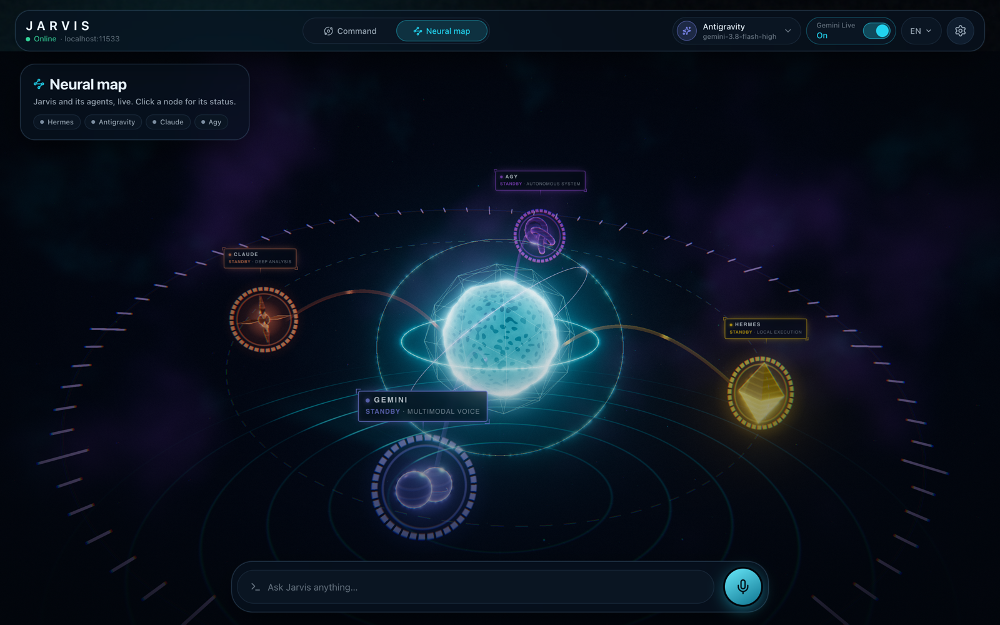
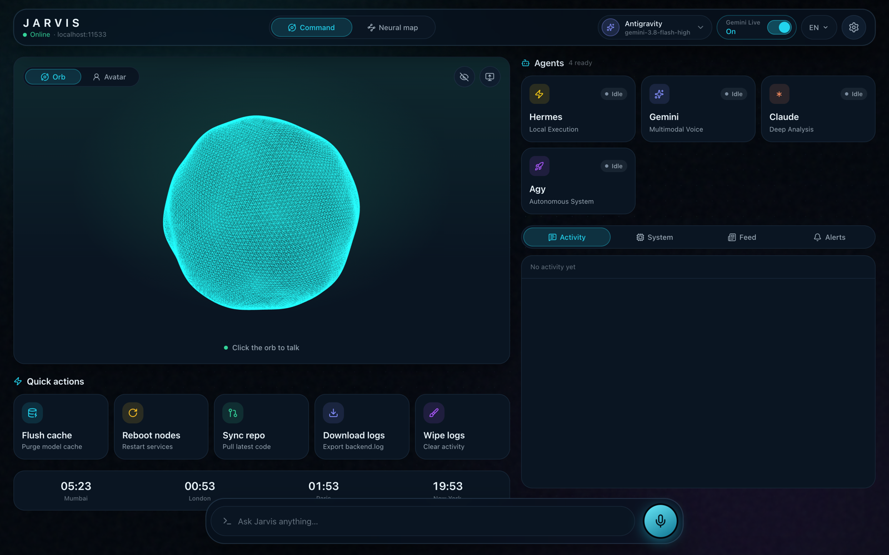
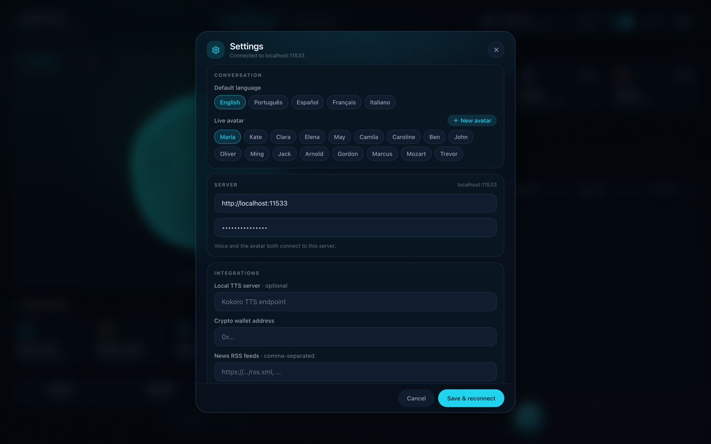
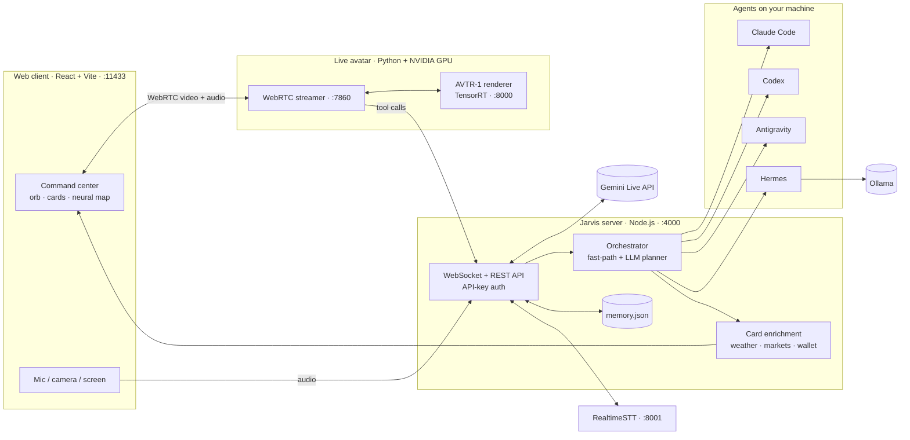

<div align="center">

# Jarvis Live

### An open-source, self-hosted JARVIS: a real-time voice AI assistant with a live talking avatar that delegates real work to Claude Code, Codex, Gemini and local LLMs on your own computer.

[](LICENSE)
[](#-quick-start)
[](https://nodejs.org)
[](https://react.dev)
[](https://ai.google.dev/gemini-api/docs/live)
[](https://ollama.com)
[](CONTRIBUTING.md)

**Talk to your computer the way Tony Stark does.** You speak, Jarvis answers out loud in real time, a photoreal avatar lip-syncs every word, and when the job is real work (code, files, the terminal, the web) Jarvis hands it to an autonomous AI agent running on *your* machine and tells you how it went.

[Quick start](#-quick-start) · [Features](#-features) · [Architecture](#-architecture) · [Live avatar](#-live-avatar-avtr-1) · [Configuration](#%EF%B8%8F-configuration) · [FAQ](#-faq)



</div>

---

## Why Jarvis Live?

Most "AI assistants" are a chat box. Jarvis Live is an **AI operating layer for your own computer**:

- 🎙️ **Real-time voice, not push-to-talk.** Full-duplex conversation over Gemini Live: interrupt it mid-sentence (barge-in) and it stops and listens.
- 🧑‍🚀 **A face, not just a voice.** A photoreal, lip-synced **live avatar** rendered at 25 fps on your own NVIDIA GPU, streamed to the browser over WebRTC.
- 🛠️ **It actually does things.** Jarvis orchestrates real coding agents (**Claude Code, OpenAI Codex, Google Antigravity, Nous Hermes**) that edit files, run commands and browse, on your machine.
- 🔒 **Yours, end to end.** No accounts, no telemetry, no vendor cloud in the middle. Your server, your keys, your data. Bring local models with **Ollama**.
- 📊 **Answers you can see.** Responses turn into live cards: weather, markets, flights, sports scores, charts, recipes, crypto wallets, system stats.

<div align="center">

</div>

## ✨ Features

### Voice
- **Gemini Live native audio**: sub-second, speech-to-speech conversation with natural voices.
- **Barge-in**: talk over Jarvis and it yields, like a real conversation.
- **Wake word** ("Hi Jarvis", "Wake up") through a local [RealtimeSTT](https://github.com/KoljaB/RealtimeSTT) server.
- **Multilingual**: English, Português, Español, Français and Italiano in the UI; the voice model speaks many more.
- **Conversation memory**: recent turns persist to `memory.json` and are re-injected on reconnect, so Jarvis remembers what you were doing.

### Agents: Jarvis delegates, they execute
| Agent | What it is | Good at |
| :-- | :-- | :-- |
| **Claude** | [Anthropic Claude Code](https://www.anthropic.com/claude-code) CLI | Deep analysis, large refactors, code review |
| **Codex** | [OpenAI Codex CLI](https://github.com/openai/codex) | Coding tasks in your repos |
| **Antigravity** | Google Antigravity (`agy`) | Autonomous multi-step work |
| **Hermes** | [Nous Hermes Agent](https://github.com/NousResearch/hermes-agent) on local LLMs | Private, offline execution |

Jarvis **auto-detects** which agent CLIs are installed, lists their models, routes each request with a fast-path (say "ask Claude to…") or an LLM planner, streams progress to the UI and **reads the outcome back to you**.

### Live avatar
- Photoreal talking head powered by **[AVTR-1](https://github.com/avaturn-live/avtr-1)**: lip-sync *and* active listening, 25 fps, TensorRT-accelerated.
- **18 built-in avatars** (Maria, Elena, Marcus, Kate…) fetched from Hugging Face.
- **Create your own avatar from a single photo**, optionally with a cloned voice (XTTS).
- Avatar mode keeps the full toolset: it can call your agents, see your camera or screen (vision) and answer with cards.

### Command center (web client)
- **Neural map**: a live three.js visualization of Jarvis and its agents.
- **Live cards**: weather, finance, flights, sports, charts, recipes, task roadmaps, translations, media, system telemetry and multi-chain crypto wallets, detected from answers and enriched with live data.
- **Vision**: let Jarvis see through your camera or a shared screen.
- **Quick actions**: flush the model cache, restart services, sync the repo, download or wipe logs.
- Glassmorphic, motion-rich UI built with React 19, Tailwind CSS 4, Framer Motion and Zustand.

### Local-first
- **Ollama cluster**: list as many Ollama servers as you like; Jarvis load-balances to the least busy one.
- Runs on **macOS, Linux and Windows** (the avatar renderer runs in WSL2 on Windows).
- One API key protects every HTTP and WebSocket endpoint. Nothing is preconfigured: no feeds, no wallets, no keys.

<div align="center">

</div>

## 🏗 Architecture



| Folder | What's inside |
| :-- | :-- |
| [`src/`](src) | Web client: React 19 + TypeScript + Vite, the voice stage, cards and neural map |
| [`backend/`](backend) | Jarvis server: Express + WebSocket, Gemini Live bridge, agent orchestration, card enrichment |
| [`live_avatar/`](live_avatar) | Live-avatar engine: AVTR-1 renderer + WebRTC streamer + XTTS voice server |
| [`voice_engine/`](voice_engine) | Local RealtimeSTT server with wake-word detection |
| `boot.sh` / `boot.bat` | One command to start everything |

## 🚀 Quick start

**Requirements:** Node.js 20+, a free [Gemini API key](https://aistudio.google.com/apikey). Optional: Python 3.10+ (speech-to-text), an NVIDIA GPU (live avatar), [Ollama](https://ollama.com), and any of the agent CLIs above.

```bash
git clone https://github.com/samukbg/Jarvis-Live.git
cd Jarvis-Live

cp .env.example .env
# edit .env: set API_KEY (openssl rand -hex 24) and GEMINI_API_KEY

./boot.sh          # macOS / Linux
# boot.bat         # Windows
```

Open **http://localhost:11433**, go to **Settings → Server**, paste your `API_KEY`, and click the orb to talk.

<details>
<summary><b>Manual start (two terminals)</b></summary>

```bash
# terminal 1: the server
cd backend && npm install && npm start      # http://localhost:4000

# terminal 2: the web client
npm install && npm run dev                  # http://localhost:11433
```

For production, `npm run build` and serve `dist/` behind any HTTPS reverse proxy that forwards `/api` and `/ws` to the server.
</details>

<details>
<summary><b>Voice: local speech-to-text and wake word</b></summary>

```bash
python3 -m venv voice_engine/venv
voice_engine/venv/bin/pip install -r voice_engine/requirements.txt
```
`boot.sh` starts it automatically on port 8001 once the venv exists.
</details>

<details>
<summary><b>Agents</b></summary>

Install any of these and log in once; Jarvis detects them on startup (`GET /api/agents`):

```bash
npm i -g @anthropic-ai/claude-code   # Claude
npm i -g @openai/codex               # Codex
# Antigravity (agy) and Hermes Agent: see their docs
```
</details>

## 🧑‍🚀 Live avatar (AVTR-1)

The avatar needs an **NVIDIA GPU** (Ampere or newer recommended; an RTX 3060 Ti renders in real time) with CUDA 12 and TensorRT 10.

```bash
cd live_avatar
pixi install                 # environment (https://pixi.sh)
pixi run download            # weights from the gated Hugging Face repo (accept the AVTR-1 terms first)
pixi run build-trt-engines   # compile TensorRT engines for your GPU
```

Then `./boot.sh` starts the streamer as well. On Windows, `live_avatar/setup_avatar_windows.bat` sets up the streamer natively and the renderer inside WSL2. Full details, benchmarks and TURN setup for remote access are in [`live_avatar/README.md`](live_avatar/README.md).

Switch **Orb → Avatar** in the UI, pick an avatar in Settings, or click **New avatar** to create one from a photo.

## ⚙️ Configuration

Everything lives in `.env` (see [`.env.example`](.env.example)); every setting is optional except the keys.

| Variable | Purpose |
| :-- | :-- |
| `API_KEY` | Key every client must send. If unset, a random one is generated and printed at startup |
| `GEMINI_API_KEY` | Gemini Live voice and the avatar's conversation engine |
| `OLLAMA_SERVERS` | Comma-separated Ollama URLs (default `http://localhost:11434`) |
| `STREAMER_URL` | Live-avatar streamer (default: this machine) |
| `STT_URL` | RealtimeSTT server (default `ws://localhost:8001`) |
| `HF_TOKEN` | Hugging Face token for the gated AVTR-1 weights and portraits |
| `CRYPTO_WALLET`, `NEWS_RSS_URLS` | Optional wallet and news cards; also editable in Settings |

**Security:** the server refuses requests without the key, the web client never embeds it (you enter it in Settings), and `.env` is gitignored. Expose Jarvis to the internet only over HTTPS. Agents run commands on your machine, so treat the API key like a password.

## ❓ FAQ

**Is Jarvis Live free?**
Yes. The Jarvis code is MIT-licensed. You pay only for the APIs you choose (the Gemini API has a free tier), or run models locally with Ollama.

**Can it run fully offline?**
The agents (Hermes + Ollama), speech-to-text and the avatar renderer all run locally. Real-time voice uses Gemini Live today; a fully local voice pipeline is on the roadmap.

**Do I need a GPU?**
Only for the live avatar. Voice, agents, cards and the neural map run on any laptop, including Apple Silicon Macs.

**How is this different from Siri, Alexa or ChatGPT voice?**
Jarvis runs on your hardware, controls real developer agents that change files and run commands, shows a photoreal avatar, and is hackable end to end.

**Can I use it from my phone?**
Yes: open the web client from any browser on your network, or put the server behind an HTTPS reverse proxy or tunnel.

## 🗺 Roadmap

- [ ] Fully local voice (local STT → LLM → TTS) as an alternative to Gemini Live
- [ ] Plugin API for custom tools and cards
- [ ] Docker Compose for one-command deploys
- [ ] More agent integrations

Ideas and PRs are welcome: see [CONTRIBUTING.md](CONTRIBUTING.md).

## 📜 License

The Jarvis Live code is released under the **[MIT License](LICENSE)**.

The live-avatar engine in [`live_avatar/`](live_avatar) is a modified copy of [AVTR-1](https://github.com/avaturn-live/avtr-1) by Goodsize Inc. and keeps **its own licenses**: the streamer and renderer are under PolyForm Noncommercial 1.0.0 and the model weights under the AVTR-1 Community License (see [`live_avatar/LICENSE.md`](live_avatar/LICENSE.md)). Commercial use of the avatar requires a license from its authors.

## 🙏 Acknowledgements

[AVTR-1](https://github.com/avaturn-live/avtr-1) · [Gemini Live API](https://ai.google.dev/gemini-api/docs/live) · [RealtimeSTT](https://github.com/KoljaB/RealtimeSTT) · [Coqui XTTS](https://github.com/idiap/coqui-ai-TTS) · [Ollama](https://ollama.com) · [three.js](https://threejs.org) · [TalkingHead](https://github.com/met4citizen/TalkingHead)

<div align="center">

**If Jarvis Live made you smile, give it a ⭐: it helps other builders find it.**

<sub>Keywords: open-source Jarvis AI assistant, self-hosted voice assistant, real-time AI avatar, talking head, lip-sync, Gemini Live, Claude Code voice control, Codex, AI agent orchestrator, local LLM, Ollama, Iron Man JARVIS, WebRTC, React, Node.js</sub>

</div>
